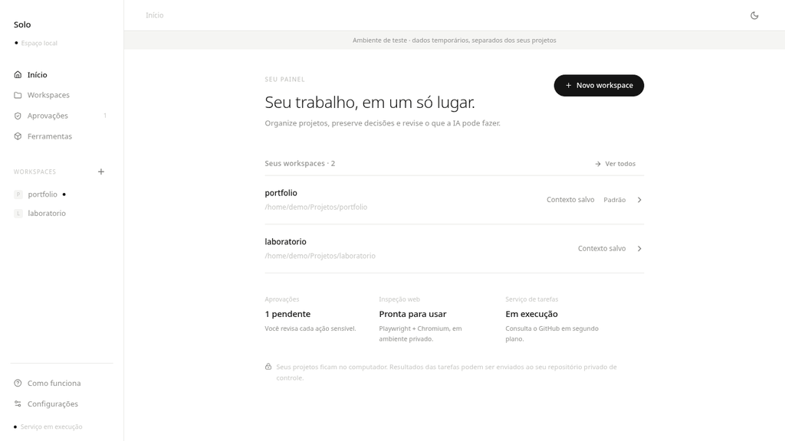
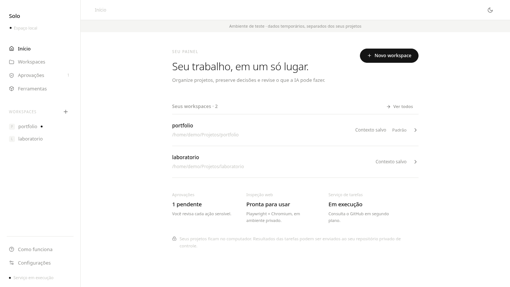
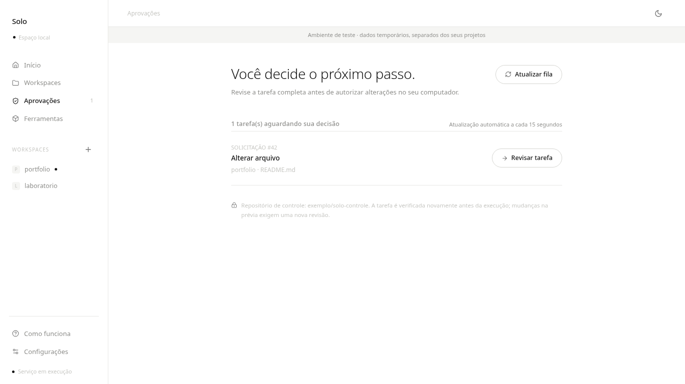
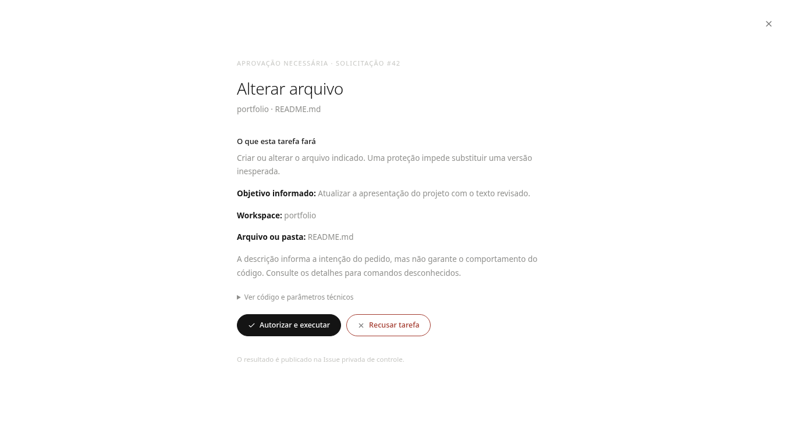

# Solo

[English](README.en.md) · [Português](README.md) · [Releases](https://github.com/trajanoeliane75-arch/Solo-MCP/releases) · [Desktop guide](docs/GUI.md)

**Ran out of ChatGPT Work or Codex credits in the middle of a project? Keep working on your own Linux PC.**

**Solo** is a local Linux companion for ChatGPT. Your conversation sends task requests through **private GitHub Issues**, while your PC hosts the actual workspace and executes permitted operations. Solo prompts you to **review and approve sensitive tasks** before they run.

*Demonstration of the Solo interface with fictional example data. No actual task was executed during capture.*

## How it works

1. **Ask ChatGPT** to perform a task in an existing project. The conversation needs GitHub access and creates an Issue in a **private control repository**.
2. **Solo receives the request** on your Linux desktop and checks the workspace, permissions, and task details.
3. **Review sensitive operations** in the desktop app. On approval, Solo performs permitted work locally, reports the result in the private Issue, and the conversation can read that result.

The source-code repository may be public, but your **control repository must be private**. Solo is **not an MCP protocol server**, does not restore credits, and does not bypass the usage limits of any AI subscription. Local files are not automatically uploaded to GitHub, although task results and requested content may be posted in your private Issues.

## Interface

| Home and workspaces | Pending approvals |
|---|---|
|  |  |

## Debian/Ubuntu .deb package (v1.0.1+)

From **Solo v1.0.1**, you can [download the native Debian package from Releases](https://github.com/trajanoeliane75-arch/Solo-MCP/releases/latest). Look under *Assets* for **solo-agent_1.0.1_all.deb**. Open it in your distribution's graphical package manager or install it with:

~~~bash
sudo apt install ./solo-agent_1.0.1_all.deb
~~~

The package installs Solo into the desktop applications menu and registers its original icon. **It does not automatically migrate, replace, or restart an existing user background service.** If you previously installed Solo from a ZIP or git clone, an older launcher and service may coexist with the new package. Verify both before removing the old shortcut. Your personal workspaces and ~/.config/solo-mcp/ configuration are not deleted by package removal.

See the [Debian packaging guide](packaging/deb/README.md). Fedora and Arch users should continue using the source installation instructions.

## Installation

**Platform:** Linux desktop, Python 3, GTK 3 and WebKitGTK 4.1. Debian/Ubuntu are the main tested target; the GUI can guide dependency setup **when GTK3 and Polkit are already installed**. Fedora and Arch require manual dependency installation as documented in [docs/GUI.md](docs/GUI.md). X11 is required for native window capture. Windows and macOS are not supported.

Download the source code and run the installer:

~~~bash
git clone https://github.com/trajanoeliane75-arch/Solo-MCP.git
cd Solo-MCP
./install.sh
~~~

Alternatively, open **Solo-MCP.desktop** from the extracted repository folder in your file manager and allow it to launch when prompted. The application is displayed as **Solo**. Internal file, service and protocol identifiers retain the historical solo-mcp naming for compatibility.

On first use:

1. Open **Settings (Configurações)** and connect your GitHub account in the browser.
2. Create a **separate private GitHub control repository** and configure it in Solo. Never put tokens or passwords in Issues.
3. Add a local **workspace** pointing to an existing project directory.
4. Review workspace permissions and activate the background service.
5. Ask ChatGPT, with access to GitHub, to create a task in that private repository. Sensitive requests wait in **Approvals (Aprovações)**.

The current GUI is in **Portuguese**. This page provides an English introduction, while most detailed guides remain in Portuguese.

## Capabilities

- Desktop home screen, local workspaces, optional shared Markdown context, and local Git information.
- Per-workspace permissions and explicit approval for sensitive operations.
- Private GitHub Issues transport, including execution results, and a background Linux user service.
- Local file/document operations and selected Python or development commands, subject to permissions.
- Optional Playwright/Chromium web inspection, X11 window capture, and Podman rootless workflows.
- Native GTK first-run dialogs and a GTK/WebKitGTK desktop UI; no Electron.

**Safety limitations:** Approved terminal commands may run with your Linux user's privileges and are **not automatically sandboxed**. Podman isolation is optional and does not wrap every task. Review each command before authorizing; do not run the service as root or share your private control repository with untrusted people.

## Systems and releases

| System | Availability |
|---|---|
| Debian/Ubuntu Linux | Primary target, with GTK-based guided setup for supported components |
| Fedora/Arch Linux | Dependencies must be installed manually; follow the desktop guide |
| Linux on Wayland | General desktop support depends on the session; X11 window capture unavailable |
| Windows and macOS | Not supported |

The [Releases page](https://github.com/trajanoeliane75-arch/Solo-MCP/releases) contains versioned **source code archives**, not compiled binaries. Version v1.0.0 does not include a .deb, AppImage, Windows .exe or macOS .dmg.

More: [desktop setup](docs/GUI.md), [workspaces](docs/WORKSPACES.md), [visual inspection](docs/INSPECTION.md), [sandbox and permissions](docs/PROJECTS_SANDBOX.md).

## License and contributions

Solo is **source-available** under [PolyForm Noncommercial 1.0.0](LICENSE). Commercial use is restricted. The license is **not OSI-approved open source**.

Issues and focused pull requests are welcome; see [CONTRIBUTING.md](CONTRIBUTING.md). The scope remains the simple request → review → execute → report workflow, rather than an ever-growing general-purpose AI platform.
